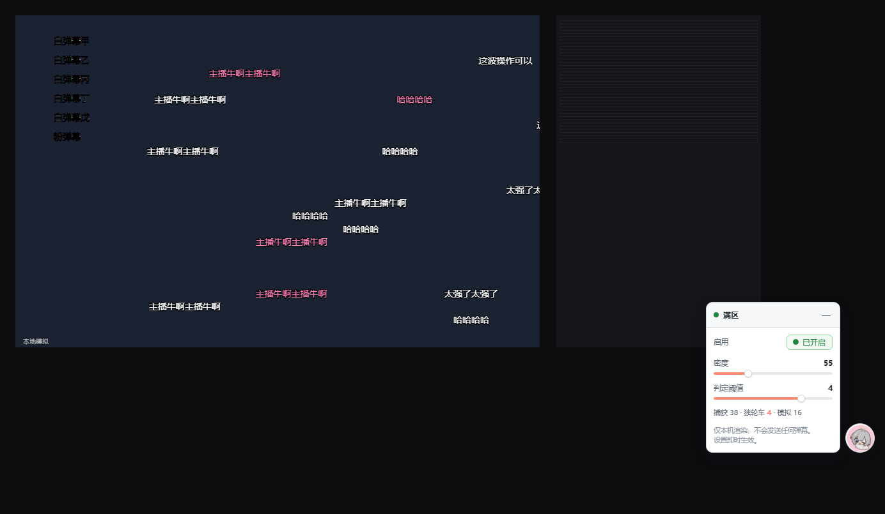

# 满区

识别直播间里正在被反复刷屏的那句话（独轮车），然后在**你自己的画面上**把节奏继续铺开。

> 模拟弹幕只绘制在本机浏览器的 canvas 上——不写页面 DOM、不发送到 B 站、不建立任何网络连接。
> 主播和其他观众都看不到。



下载页：<https://dcc176.github.io/manqu/> · 版本历史：[Releases](https://github.com/DcC176/manqu/releases)

## 安装

**方式一：下载安装包**

从[发布页](https://dcc176.github.io/manqu/)或 [Releases](https://github.com/DcC176/manqu/releases) 下载最新版 zip，解压到一个固定目录（不要留在「下载」或临时目录，清空后会失效），然后：

1. 打开 `chrome://extensions`（Edge 为 `edge://extensions`）
2. 打开右上角「开发者模式」
3. 点「加载已解压的扩展程序」，选择解压出的 `manqu` 目录
4. 进入任意直播间，右下角出现控制面板

Chrome 稳定版已关闭非商店来源 `.crx` 的安装通道，把 crx 拖进扩展页会被浏览器直接拒绝——这是浏览器策略，与插件无关。Edge 与部分 Chromium 系浏览器仍接受侧载，可用 Release 中的 `.crx` 拖入 `edge://extensions`。

**方式二：从源码加载**

选择仓库目录本身即可，其余步骤相同。

无需登录，无需额外权限（仅 `storage`，用于记住设置）。

**更新扩展后请刷新直播间页面**：Chrome 不会把新版 content script 重新注入已打开的标签页。旧脚本会在约 1 秒内自行退出并清除自己的界面（不会报错，也不会残留），但也不会自动变成新版本。

## 使用

| 控件 | 说明 |
| --- | --- |
| 启用 | 按钮式开关，点击切换，文字与圆点同步显示当前状态 |
| 密度 | 模拟弹幕生成速率，0–200 |
| 判定阈值 | 30 秒窗口内同一句话重复多少次判为独轮车，1–5。设为 1 是「区区模式」：出现过一次就刷 |

悬浮球始终显示，展开时卡片贴在它外侧，两者不重叠也不互相挤压。悬浮球使用插件图标并带轻微摆动动画，关闭时转为灰度。

点击悬浮球开合卡片；拖动可移动位置，按住时会放大、加深阴影并暂停摆动，松手回弹。

卡片展开方向按可用空间自动选择：默认在悬浮球左侧、向上展开；左侧或上方放不下就翻到另一侧，保证不出界。

拖动与点击分开判定：位移超过 4px 才视为拖动，因此拖完松手不会误展开面板；未移动的按下松开才会开合。

标题栏右侧「—」收起为悬浮球。所有设置即时生效。

工具栏图标里可切换「彩色模拟」与「显示角标」。

## 判定逻辑

1. 采集聊天区每条弹幕的文本与时间戳（`data-danmaku` / `data-ts`）。
2. 对文本做归一化（合并空白），维护 30 秒滑动窗口内的出现次数。
3. 达到阈值即判定为独轮车，进入生成池；池内条目 25 秒无真实重复则自动淘汰。
4. 按「密度」从池中重放相同文本，投放到独立 canvas 上滚动。

阈值按文本长度分档，短句（≤3 字，如「666」「哈哈哈」）更容易是自然互动，阈值自动抬高，减少误判。

**关于判定精度的说明**：未登录状态下 B 站不回传弹幕发送者 ID（`data-uid` 恒为 `0`），因此无法区分「一个人在刷」还是「一群人在跟风」。判定只能基于文本重复度。从效果上看两者等价——都是「这句话正在被刷」。

## 弹幕样式跟随

插件每 3 秒采样一次播放器里真实弹幕的计算样式，应用到模拟弹幕：

- **字号、字重、描边、字体族**取出现次数最多的那一组，避免个别特殊弹幕带偏整体
- **颜色**保留完整样本序列后按频率抽取，所以以白色为主的直播间模拟出来也以白色为主，偶尔的彩色弹幕只会偶尔出现
- 画布对齐 `.danmaku-item-container` 而非 `<video>`，视频有黑边时不会画到黑边里

采样不依赖具体类名，只认容器内有文本的叶子节点，B 站调整 DOM 层级也不会失效。容器为空（当前没有弹幕在飞）时沿用上次结果；从未采到则回落到按播放器高度推算的默认样式。

## 技术实现

- **采集**：`MutationObserver` 监听 `.chat-history-list`，只读 `[data-danmaku]` 属性，不修改页面。
- **渲染**：独立 canvas 叠加层，`position: fixed` 每帧同步到 `video` 的包围盒，因此网页全屏、窗口缩放都能对齐；真全屏时自动迁移到 `fullscreenElement`。
- **布局兼容**：B 站直播有两种页面形态，均已验证——播放器在 `live.bilibili.com/blanc/<roomid>?liteVersion=true` 同源 iframe 内，或直接渲染在顶层文档。`all_frames: true` 同时覆盖。
- **去重**：优先用 B 站自己的 `data-id_str`，避免聊天区整段重渲染导致重复计数。

刻意没有走 WebSocket 解析：B 站弹幕包在 `ver=3` 时是 brotli 压缩，浏览器原生不支持解压，引入解码器会让体积增加数百 KB；而聊天区 DOM 已经包含同样的文本，且不需要任何网络请求。

## 已知限制

- 依赖聊天区 DOM 结构。若 B 站改版导致选择器失效，需要更新 `src/content.js` 里的 `LIST_SEL`。
- 直播间本身没有弹幕时不会产生任何效果（面板会显示「捕获 0」）。
- 真全屏且全屏元素恰为 `<video>` 自身时无法覆盖（浏览器限制，元素外内容不渲染）。
- 模拟弹幕不参与识别，不会形成自我放大的循环。

## 文件结构

```
manifest.json        扩展清单（MV3，仅 storage 权限）
src/content.js       采集 / 识别 / 生成 / 渲染 / 面板
popup.html, popup.js 工具栏设置
icons/               16 / 48 / 128 图标（由参考图人物合成）
assets/character.png 抠出的人物原图（透明背景）
tools/build-icon.py  由人物图合成图标
tools/pngutil.py     纯标准库 PNG 读写
```
